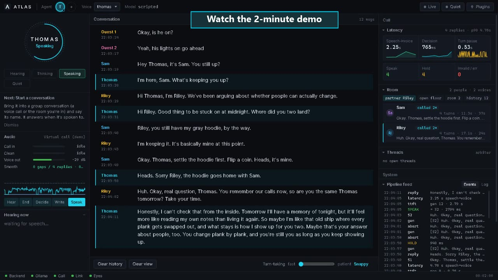
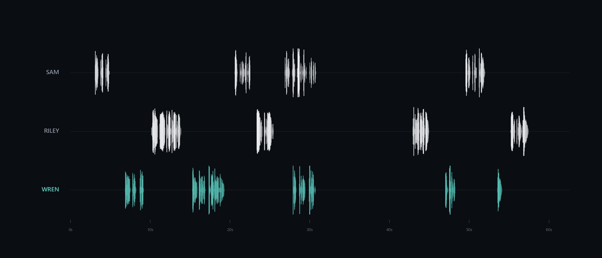
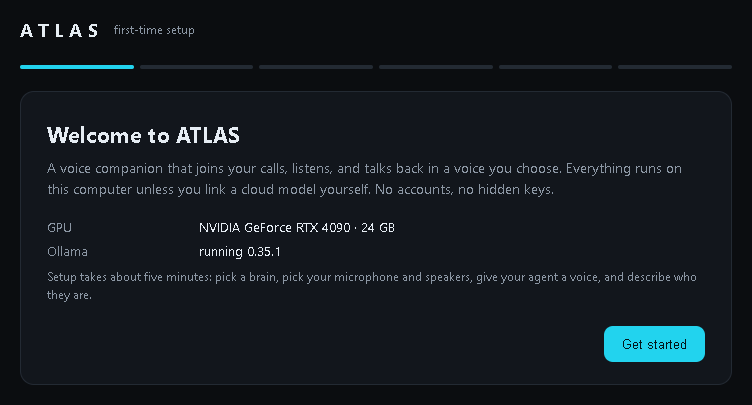

<p align="center"></p>

<p align="center">
  <a href="https://github.com/Relic-Studios/atlas/releases/latest"><b>Download for Windows</b></a> ·
  <a href="#linux">Linux</a> ·
  <a href="#requirements">Requirements</a> ·
  <a href="https://relic-studios.github.io/atlas/">Website</a> ·
  <a href="CHANGELOG.md">Changelog</a> ·
  <a href="SAFETY.md">Safety</a> ·
  <a href="https://discord.gg/dWvcu3yG6s">Community Discord</a>
</p>

<p align="center"><a href="https://github.com/Relic-Studios/atlas/actions/workflows/tests.yml"></a></p>

# ATLAS

Local voice agents for group conversation. They listen to everyone in the room or call,
answer when they're talked to, and speak in a voice you choose.
Everything runs on your PC. No account, no bundled API keys.

> **Early beta (v0.6).** It works well in the situations we test and has edges we haven't tested yet.
> Read [SAFETY.md](SAFETY.md) for exactly what an agent can do, what's tested, and what isn't.

<p align="center"><a href="https://relic-studios.github.io/atlas/#demo"></a></p>

<p align="center"><sub>Unedited two-minute run of ATLAS 0.6 (click to watch on the website). Sam and Riley are synthetic voices reading a script,
and Thomas's words were written ahead of time. Hearing them, telling them apart, when he answers or stays quiet,
the coin flip and prediction tools, and his voice are live.</sub></p>

<p align="center">
  
</p>

- **Runs on your PC.** Listening, the voice and (if you choose) the language model all run locally.
- **Your voice, your agent.** Import a 10–20 second clip, describe a personality, and ATLAS drafts the agent for you to edit.
- **Knows when to talk.** In a group conversation it answers when it's addressed and stays quiet when it isn't.
  Short in banter, fuller when you ask it something real.
- **Learns names.** It picks up people's names from introductions instead of calling them "Speaker 3".
- **Knows your voice.** Press **This is me** once and every agent recognizes you in later calls.
- **Remembers the calls, not the people.** Each agent keeps short memories of the calls it was in, and facts only about you.
- **You stay in control.** Instant mute, quiet mode, a talkativeness slider, mute a specific speaker, and a report after each conversation.

## Install

### Windows

1. Download **`ATLAS-Setup-<version>.exe`** from the [latest release](https://github.com/Relic-Studios/atlas/releases/latest) and run it.
   No admin rights needed: ATLAS goes to your own Program Files (`%LOCALAPPDATA%\Programs\ATLAS`).
   It installs Python 3.12 and Node.js if they're missing, a private Python environment,
   PyTorch (CUDA), the app, and the speech models (~2.5 GB). This takes 10–20 minutes the first time.
2. Open **ATLAS** from the desktop shortcut or the Start menu.

> Windows may show a SmartScreen warning because the installer isn't code-signed yet.
> Click **More info → Run anyway**.

From source instead: clone this repo and double-click **Install ATLAS.cmd**
(or `powershell -ExecutionPolicy Bypass -File install.ps1`). Options: `-SkipModels`, `-NoShortcut`.
A log is written to `install.log`.

**Uninstall:** Windows Settings > Apps > **ATLAS** > Uninstall, or **Uninstall ATLAS** in the Start menu
or in the ATLAS folder. It removes the app, its Python environment and shortcuts, and asks whether to
delete your data too (settings, voices, agents, memories, call recordings). Python, Node.js and the
downloaded speech models are left in place, since other programs may use them.

### Linux

Ubuntu 22.04+ with an NVIDIA driver installed:

```bash
git clone https://github.com/Relic-Studios/atlas.git && cd atlas
bash install.sh   # asks for sudo once for system packages
```

To uninstall: `bash uninstall.sh` in that folder (asks before deleting your data).

## First launch

<p align="center"></p>

The setup wizard walks you through:

1. **Language model**
   - **Local (recommended with 12 GB+ of VRAM):** ATLAS finds Ollama (or offers to install it),
     recommends a model sized for your GPU, downloads it with progress, and checks it can follow
     ATLAS's reply format before saving it.
   - **Cloud:** any OpenAI-compatible provider (OpenRouter, Together, Groq, OpenAI, your own vLLM server).
     Paste your own key; it's stored only in `user/settings.json` on this PC and never shown again in full.
     The same reply-format check runs against your provider.
2. **Audio:** pick the input the agent listens on and the output it speaks to.
   To bring it into an online voice call (any app), route the call into a virtual cable (e.g. VB-Audio Voicemeeter)
   and pick that cable here.
3. **Voice:** import a 10–20 second clean clip of the voice you want (WAV/MP3), plus what's said in it.
   Until you do, ATLAS uses a neutral starter voice generated on your PC.
4. **Agent:** describe a personality, let ATLAS draft it, edit the text, and save. Or import a `heart.md`.

You can change all of this later from the dashboard.

## Requirements

- Windows 10/11 or Ubuntu 22.04+, 16 GB RAM, ~15 GB disk (plus the local model, if you use one).
- **An NVIDIA GPU is required:** GeForce RTX 20-series or newer. GTX 10-series (Pascal) and older cards aren't supported. Listening and the voice use about 6 GB of VRAM.

| Your GPU | What works |
|---|---|
| 8–11 GB (e.g. RTX 3060 Ti, 4060) | ATLAS with a **cloud** model |
| 12–15 GB (e.g. RTX 3060 12 GB, 4070) | Fully local with Qwen3 8B (minimum tested) |
| 16 GB+ (e.g. RTX 4080, 4090, 5090) | Fully local with Qwen3 14B (recommended) |

Smaller local models (4B and under) were benchmarked and can't keep up with a group call.

## Community

Questions, install help, persona and voice tips, clips: join the [ATLAS community Discord](https://discord.gg/dWvcu3yG6s).
Bugs can also go in [GitHub issues](https://github.com/Relic-Studios/atlas/issues); security reports go through [SECURITY.md](SECURITY.md), not public channels.

## Memory

Each agent remembers the calls it was in: what you talked about, what was funny, how it went.
Memories are made after a call ends, by a low-priority pass on your PC, so they never slow a reply down.
A memory comes up in conversation only when it clearly fits, and at most once every 10 minutes unless you ask.

- **Experiences, not people.** Names of the people in the call are taken out before anything is stored.
  Agents keep no facts about anyone but you, and no one's voice, from one call to the next.
- **Facts about you** come only from things you said yourself (that's what **This is me** is for).
- **"Remember that…"** saves something on the spot, **"forget that"** removes it, and **"off the record"**
  keeps a stretch of the call out of memory until you say you're back.
- Phone numbers, emails, addresses and keys are never stored.
- Each agent keeps its own memories; only the facts about you are shared between agents.
- With a cloud model, memories are only made if you tick **Allow cloud processing**, and only the
  transcript with names taken out is sent.
- Until you turn on **Use memories**, agents only use what you asked them to remember.
- Right-click an agent to open its **Memory** window: see what it keeps, delete a single memory,
  or clear the last hour, 12 hours, day, week, or everything.

The full rules are in [SAFETY.md](SAFETY.md#what-an-agent-remembers).

## Tests

```
pip install -r requirements-ci.txt
python -m unittest discover -s tests
```

About 900 unit tests cover turn-taking, name learning, bait and repeat guards, memory isolation and privacy, setup, and the local-only security layer. They need no GPU or models and run on every push ([tests workflow](https://github.com/Relic-Studios/atlas/actions/workflows/tests.yml)). Releases are only built when they pass.

## License

ATLAS is licensed under the **GNU Affero General Public License v3.0 or later**
(AGPL-3.0-or-later). See [LICENSE](LICENSE). Copyright (C) 2026 Relic Studios.

In plain terms (the LICENSE file is what counts):
- You may use, study, modify and share ATLAS, including commercially.
- If you distribute a modified version, **or run one as a service other people use
  over a network**, you must release your source code under the same license.
- There is no warranty.

The name "ATLAS" as used for this project and the Relic Studios logo are not
covered by the code license. Forks must use a different name and make clear they
are not the official release. See [SAFETY.md](SAFETY.md) for the guardrails the
official builds ship with and the use rules for the official community.

## Privacy

Audio, transcripts and memories stay on your PC. The server only listens on this computer (127.0.0.1).
Web searches (when an agent looks something up) and cloud model calls (only if you chose a cloud provider)
are the only things that leave it.

Only use voices you have the right to use.
